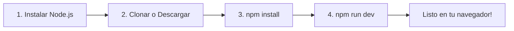
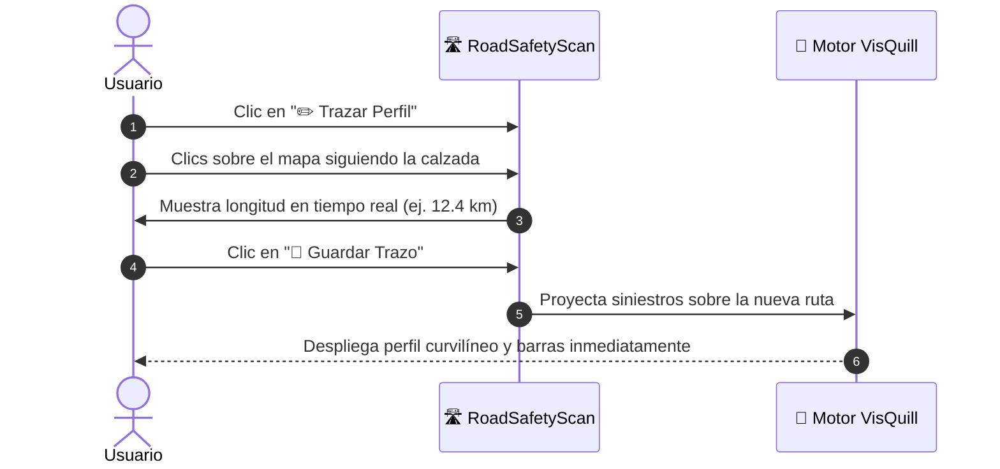

# 🛣️ RoadSafetyScan - Perfil Curvilíneo de Seguridad Vial

> **Plataforma web interactiva para la auditoría, análisis espacial y diagnóstico de seguridad vial en carreteras del Perú.**  
> Diseñada para ser simple, visual y directa: procesa datos de siniestros viales directamente en tu navegador web sin necesidad de instalar bases de datos complejas ni configurar servidores backend.

---

### 💖 Agradecimiento Especial a VisQuill

Queremos expresar nuestro más sincero agradecimiento y reconocimiento a **VisQuill**.  
Esta plataforma utiliza el paradigma visual y la metodología de **Profiles along a line (VisQuill GDK A1 Collision Density)**. Gracias a la ingeniería geométrica desarrollada por **VisQuill**, es posible proyectar la densidad de accidentes a lo largo de una línea base paralela al trazado vial, convirtiendo matrices numéricas complejas en perfiles gráficos legibles, armónicos e intuitivos para ingenieros, auditores y la comunidad. ¡Infinitas gracias a **VisQuill** por inspirar e impulsar esta herramienta!

---

## ⚡ ¿Cómo Desplegar y Poner en Marcha la Aplicación?

No necesitas conocimientos avanzados de programación. Solo requieres tener instalado **Node.js** en tu computadora (se descarga gratis desde [nodejs.org](https://nodejs.org/)).



### Opción 1: Usarla en tu computadora (Modo Local)

1. **Descarga el proyecto:**  
   Si usas Git, abre tu terminal y escribe:
   ```bash
   git clone https://github.com/N4kamura/RoadSafetyScan.git
   cd RoadSafetyScan
   ```
   *(Si descargaste el archivo en un `.zip`, descomprímelo en tu carpeta preferida y abre la terminal en esa carpeta).*

2. **Instala las dependencias necesarias:**
   ```bash
   npm install
   ```

3. **Inicia la aplicación:**
   ```bash
   npm run dev
   ```

4. **Abre tu navegador web:**  
   Ingresa a la siguiente dirección:
   ```
   http://localhost:5173
   ```
   ¡Y listo! Ya puedes interactuar con el mapa, los siniestros y los perfiles de seguridad vial.

---

### Opción 2: Publicarla en Internet (Despliegue Web Gratuito)

Como **RoadSafetyScan** funciona 100% en el navegador del usuario (arquitectura *Client-Side*), puedes alojarla de forma gratuita y sin servidores en plataformas como **GitHub Pages**, **Vercel** o **Netlify**:

1. En la terminal de tu proyecto, compila los archivos listos para internet:
   ```bash
   npm run build
   ```
2. Esto creará una carpeta llamada `dist/`.
3. Sube el contenido de la carpeta `dist/` a tu proveedor de hosting favorito:
   - **Netlify / Vercel:** Puedes arrastrar la carpeta `dist/` directamente a su panel web.
   - **GitHub Pages:** Sube la carpeta generada a la rama `gh-pages` de tu repositorio.
4. Cualquier persona con el enlace web podrá usar la herramienta inmediatamente, desde cualquier dispositivo y sin necesidad de instalar nada.

---

## 📖 Manual Didáctico de Uso: Paso a Paso

A continuación, te guiamos por todas las herramientas y funciones de la plataforma para que puedas auditar cualquier tramo vial como un experto.

```
+-----------------------------------------------------------------------------------+
| 🛣️ RoadSafetyScan | Ruta: Panamericana | BBDD ONSV: 2021-2025 | 🌙 Modo | ✏️ Trazar |
+------------------------+----------------------------------------------------------+
|  PANEL LATERAL         |  VISTA CARTOGRÁFICA INTERACTIVA                          |
|                        |                                                          |
|  🛣️ Rutas y Trazos     |   [ 📊 Siniestros ] [ 🚗 Vehículos ] [ 👥 Personas ]      |
|  • Panamericana        |                                                          |
|  • Exploración Libre   |        (Carretera Principal)                             |
|                        |      ═══════════════════════════════════                 |
|  📏 Parámetros LRS     |         |    |||      ||     |      |                     |
|  • Faja (Buffer): 25m  |      ···|····|||······||·····|······|··· (Línea VisQuill)|
|  • Tramo (Bin): 100m   |                                                          |
|                        |      [ ≡ ] Handle de escala vertical                     |
|  📊 Dimensiones        |                                                          |
|  • Siniestros          |      ⏰ Reloj de 24 Horas        🗺️ Leyenda               |
|  • Personas (Colores)  +----------------------------------------------------------+
|  • Severidad EPDO      |  📊 PERFIL LONGITUDINAL SINCRONIZADO (VisQuill GDK)      |
|                        |   _/\_/\___/\_____/\_  (km 18+000 al km 25+000)          |
+------------------------+----------------------------------------------------------+
```

---

### 1. Seleccionar un Corredor o Explorar Libremente

En el panel lateral izquierdo encontrarás la sección **Rutas y Trazados Viales**:

- **🛣️ Ruta de Ejemplo (Panamericana):**  
  Carga de inmediato el tramo de la Panamericana Sur (km 18 al km 25), con su eje geodésico y los accidentes ocurridos en dicha zona.
- **🗺️ Ninguna ruta (Exploración libre por el Perú):**  
  Al elegir esta opción, el mapa libera los límites de alejamiento para que puedas alejarte y observar todo el territorio nacional (de Tumbes a Tacna). Puedes desplazarte hacia cualquier ciudad, puerto o región y revisar la siniestralidad del ONSV en todo el Perú.
- **📂 Cargar archivo personalizado:**  
  Permite abrir tus propios trazos de carretera en formato `.txt` o `.geojson`.

> [!TIP]
> Si en algún momento te desorientas en el mapa, haz clic en el botón **🎯 Recentrar** en la barra superior para volver automáticamente al eje de la carretera activa.

---

### 2. Entender el Perfil Curvilíneo de VisQuill

En lugar de mostrar accidentes como círculos acumulados difíciles de contar, la tecnología de **VisQuill** proyecta los siniestros como **barras ortogonales en paralelo a la carretera**:

- **Línea de la Carretera:** Es el eje real por donde circulan los vehículos.
- **Línea Base de VisQuill:** Es una curva continua que corre en paralelo a la carretera a una distancia fija (*Offset*).
- **Barras de Densidad de VisQuill:** A mayor concentración de accidentes o víctimas en un tramo, mayor será la altura de la barra.
- **Perfil Longitudinal Inferior (VisQuill GDK):** En la parte inferior de la pantalla verás un gráfico interactivo continuo. Si pasas el cursor o haces clic en una barra del gráfico, verás el tramo exacto iluminado en el mapa.

---

### 3. Ajustar la Faja y la Longitud de los Tramos (LRS)

En la sección **Parámetros LRS** puedes configurar el análisis según las normas técnicas de diseño vial:

- **Ancho de Faja (Buffer):**  
  Define qué tan lejos de la carretera se capturan los accidentes.
  - *5 a 15 metros:* Solo incidentes que ocurrieron estrictamente sobre la calzada.
  - *25 metros (recomendado):* Calzada, bermas y cunetas.
  - *50 a 100 metros:* Incluye vías auxiliares, intersecciones e intercambios viales cercanos.
- **Segmentación Métrica ($\Delta S$ / Bins):**  
  Agrupa la carretera en bloques métricos homogéneos.
  - *100 m:* Máximo detalle para localizar puntos negros específicos (*hotspots*).
  - *200 m:* Ideal para entornos urbanos y avenidas transitadas.
  - *500 m a 1000 m:* Recomendado para carreteras rurales, autopistas de larga distancia o reportes regionales.

---

### 4. Cambiar la Dimensión de Análisis

Puedes cambiar la métrica analizada tanto en el panel lateral como en las **pastillas flotantes sobre el mapa**:

1. **📊 Siniestros:** Muestra la cantidad total de colisiones o despistes registrados.
2. **🚗 Vehículos:** Muestra la cantidad de unidades vehiculares que participaron en los eventos.
3. **👥 Personas (Barras Apiladas por Severidad):**  
   ¡Una de las funciones más potentes de **VisQuill**! Divide la altura de cada barra en colores vivos según la gravedad de las personas:
   - 🔴 **Rojo:** Fallecido
   - 🟠 **Naranja:** Lesionado
   - ⚪ **Gris:** No se conoce
   - 🟢 **Verde:** Ileso
4. **⚖️ EPDO (Equivalente de Daños Materiales):**  
   Pondera los incidentes según el factor de severidad oficial del MTC (multiplica los eventos con víctimas mortales para priorizar intervenciones críticas de seguridad vial).

---

### 5. Ajustar Visualmente las Barras en el Mapa

- **Separación Lateral (Offset):**  
  Si las barras quedan muy cerca de la carretera o se superponen con avenidas auxiliares, ajusta el slider **Separación Lateral** o usa los botones rápidos flotantes (`800m`, `1.5km`, `3km`, `5km`) para alejarlas.
- **Lado del Gráfico:**  
  Cambia la proyección hacia la **➡️ Derecha** o hacia la **⬅️ Izquierda** según el lado de la calzada que te interese evaluar.
- **Control Táctil de Altura `[ ≡ ]`:**  
  En el mapa verás un botón rectangular **`[ ≡ ]`** junto a las barras de **VisQuill**. Haz clic sobre él y arrástralo hacia arriba o hacia abajo para aumentar o disminuir la altura de las barras en tiempo real.

---

### 6. Filtrar por Horas del Día y por Años

- **⏰ Reloj Circular Dinámico de 24 Horas:**  
  Ubicado en la esquina inferior izquierda del mapa. Puedes arrastrar sus manecillas para aislar una franja horaria:
  - *Ejemplo nocturno:* Filtra de 22:00 a 05:00 hrs para estudiar siniestros en la madrugada.
  - *Ejemplo hora punta:* Filtra de 07:00 a 09:00 hrs para evaluar el tráfico matutino.
- **📅 Filtro por Años (2021 al 2025):**  
  Utiliza los botones **Todos**, **Último Año** o marca los chips de los años que deseas evaluar para comparar la evolución histórica.

---

### 7. ✏️ Dibujar y Auditar una Nueva Carretera

¿Deseas auditar una vía que no está en la lista? ¡Puedes dibujarla tú mismo en segundos!



1. Presiona el botón azul **`✏️ Trazar Perfil`** en la barra superior.
2. Haz clics sucesivos sobre el mapa siguiendo el trazado de la calle o carretera. Cada clic añadirá un vértice geodésico y verás la distancia acumulada en metros.
3. Cuando termines el recorrido, haz clic en **`💾 Guardar Trazo`**.
4. Asígnale un nombre a tu ruta.  
   - Se guardará de forma permanente en tu navegador (aunque cierres la ventana o recargues la página).
   - El motor de **VisQuill** calculará inmediatamente el perfil curvilíneo para tu nuevo eje.
5. Puedes hacer clic en **`🔒 Bloquear`** para proteger la ruta de ediciones accidentales, o presionar **`Descargar (.txt / GTFS)`** para respaldarla en tu computadora.

---

### 8. 📥 Exportar Resultados a Excel y Sistemas SIG

En la parte inferior del panel lateral tienes accesos directos para descargar tu estudio:

- **📊 Descargar Reporte CSV:** Genera una planilla codificada en UTF-8 lista para abrir directamente en **Microsoft Excel** con los kilómetros, progresivas, conteos de fallecidos, heridos y severidad por cada tramo de 100m.
- **📍 Descargar Siniestros GeoJSON LRS:** Archivo geográfico con cada siniestro proyectado a la carretera, listo para **QGIS** o **ArcGIS**.
- **🗺️ Descargar Tramos del Corredor (SIG):** Polígonos de faja y segmentos para mapas temáticos profesionales.
- **📄 Descargar Trazo de Eje (.txt):** Listado de coordenadas geográficas en formato liviano.
- **🚍 Descargar Rutas GTFS (`routes.txt`, `shapes.txt`):** Estándar internacional de transporte para interoperabilidad con plataformas de movilidad.

---

### 9. Comodidades de Visualización

- **Modo Claro / Oscuro (`🌙 / ☀️`):** Cambia el tema visual con un solo clic. La aplicación recuerda tu preferencia para la próxima vez que entres.
- **Ocultar / Mostrar Panel Lateral (`◀ Panel`):** Presiona este botón para ocultar el panel izquierdo y disfrutar del mapa y los perfiles de **VisQuill** en pantalla completa.
- **Minimizar Leyenda y Perfil:** Si deseas más espacio cartográfico, puedes replegar la leyenda y el gráfico inferior con sus botones de flecha.

---

## 🔄 ¿Cómo Actualizar la Aplicación y sus Datos?

Mantener tu sistema al día es muy fácil. A continuación te explicamos cómo actualizar cada componente:

### 1. ¿Cómo agregar o actualizar carreteras y rutas?

Tienes dos caminos según tu preferencia:

- **Método Rápido (Sin tocar código):**  
  Abre la aplicación en tu navegador, pulsa **`📂 Importar Eje`** y selecciona tu archivo `.geojson` o `.txt`, o utiliza la herramienta **`✏️ Trazar Perfil`** para dibujarla. La ruta quedará guardada de inmediato en tu navegador.
- **Método Permanente (Para incluirla en el proyecto para todos los usuarios):**  
  Guarda el archivo de tu trazo en la carpeta `routes/` (y una copia en `public/routes/`). Si cuentas con el paquete GTFS, añade las coordenadas en `routes/manifest.json`.

---

### 2. ¿Cómo actualizar los datos de siniestros viales (ONSV / MTC)?

El proyecto utiliza un archivo central optimizado ubicado en:
```text
public/data/crashes_web.json
```

- **Para actualizar directamente:**  
  Solo debes reemplazar este archivo `crashes_web.json` con el nuevo dataset que contenga los siniestros georreferenciados (con sus campos de latitud, longitud, año, hora y gravedad). Al recargar la página, la aplicación leerá los nuevos datos de inmediato.

- **Para actualizar desde los libros Excel originales del ONSV (Opcional con Python):**  
  Si el MTC publica nuevas matrices anuales en formato Excel:
  1. Coloca los tres archivos Excel en la carpeta `db/`:
     - `BBDD ONSV - SINIESTROS FATALES 2021-2025 (preliminar).xlsx`
     - `BBDD ONSV - VEHICULOS 2021-2025 (preliminar).xlsx`
     - `BBDD ONSV - PERSONAS 2021-2025 (preliminar).xlsx`
  2. Ejecuta en tu terminal el script automatizado:
     ```bash
     python scripts/build_database.py
     ```
  3. El script limpiará los datos, generará la base de datos `roadsafety.db` y actualizará automáticamente el archivo `public/data/crashes_web.json`.

---

### 3. ¿Cómo actualizar el código de la aplicación a una versión más reciente?

Si se publican mejoras o nuevas funciones en el repositorio:

1. Abre la terminal en la carpeta de tu proyecto.
2. Descarga las últimas actualizaciones:
   ```bash
   git pull origin main
   ```
3. Actualiza cualquier paquete nuevo ejecutando:
   ```bash
   npm install
   ```
4. Si lo tienes desplegado en producción, vuelve a generar la carpeta de publicación:
   ```bash
   npm run build
   ```
   ¡Y listo! Tu plataforma contará con todas las novedades y mejoras.

---

## 🏛️ Estructura Simplificada de Carpetas

Para que sepas exactamente dónde encontrar cada elemento importante:

```text
RoadSafetyScan/
├── public/                     # Archivos que se sirven en la web
│   ├── data/crashes_web.json   # 📊 Base de datos web con los siniestros del ONSV
│   └── routes/                 # 🛣️ Rutas de ejemplo y trazos GTFS
├── db/                         # Base de datos SQLite3 y Excels originales del MTC
├── routes/                     # Archivos de rutas en texto plano (.txt) y GTFS
├── scripts/                    # Scripts de Python para procesar Excels de ONSV
├── dist/                       # Carpeta generada con 'npm run build' lista para internet
├── index.html                  # Página web principal de la aplicación
└── package.json                # Configuración de comandos y dependencias
```

---

## ⚖️ Licencia y Atribución

Este proyecto es software libre y abierto bajo la licencia **[MIT License](file:///d:/Projects/RoadSafetyScan/LICENSE)**.

- **Uso Comunitario e Institucional:** Disponible libremente para municipalidades, gobiernos regionales, universidades, la Policía Nacional del Perú (PNP), SUTRAN, ATU y cualquier ciudadano comprometido con salvar vidas en las vías del país.
- **Reconocimiento Fundamental a VisQuill:** Reiteramos nuestro especial agradecimiento a **VisQuill** por el desarrollo del modelo de visualización **Profiles along a line (VisQuill GDK)**. Su enfoque matemático y cartográfico es el pilar que hace posible esta plataforma.
- **Datos Públicos:** Los datos de siniestros pertenecen a las estadísticas oficiales del **Observatorio Nacional de Seguridad Vial (ONSV)** del Ministerio de Transportes y Comunicaciones (MTC) del Perú.
