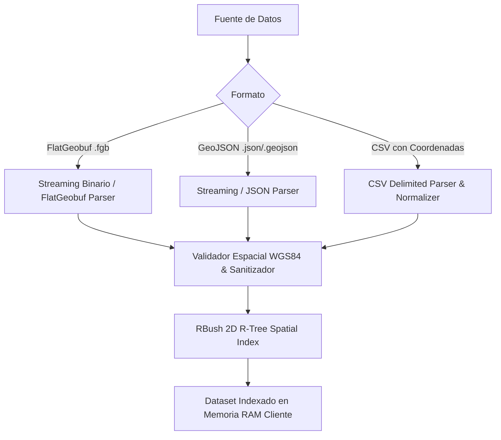

# SPEC-01: Ingesta e Indexación Espacial de Siniestros Viales

- **ID:** SPEC-01
- **Módulo:** `pkg/data`
- **Estado:** `STANDBY` (Pausado temporalmente; resuelto mediante dataset sintético en `mock/crashes.json`)
- **Dependencias:** Ninguna (módulo base del sistema)
- **Trazabilidad:** [Constitution - Module 1 & Principle 2](file:///d:/Projects/RoadSafetyScan/constitution.md#L43-L50)

---

## 1. Propósito y Alcance

Definir los mecanismos de ingesta, normalización, validación geoespacial e indexación en memoria en el navegador para conjuntos de datos de siniestros viales. 

El módulo permite cargar y consultar de forma ultra-rápida (menos de $5\text{ ms}$ por consulta espacial de bounding box) decenas de miles de siniestros de tránsito ocurridos en Perú (fuentes PNP, SUTRAN, SINAREVI/MTC, Observatorio Nacional de Seguridad Vial - ONSV).

---

## 2. Modelos de Datos y Esquemas TypeScript

### 2.1 Enums de Dominio (Normativa Peruana)

```typescript
export enum SeverityLevel {
  FATAL = 'FATAL',                     // Al menos un fallecido
  LESIONES_GRAVES = 'LESIONES_GRAVES', // Lesionados con hospitalización / descanso médico > 15 días
  LESIONES_LEVES = 'LESIONES_LEVES',   // Lesionados con descanso médico <= 15 días
  SOLO_DANOS = 'SOLO_DANOS'            // Daños materiales sin heridos
}

export enum CrashType {
  CHOQUE = 'CHOQUE',
  ATROPELLO = 'ATROPELLO',
  VOLCADURA = 'VOLCADURA',
  DESPISTE = 'DESPISTE',
  CAIDA_PASAJERO = 'CAIDA_PASAJERO',
  INCENDIO = 'INCENDIO',
  OTRO = 'OTRO'
}

export enum VehicleClass {
  AUTOMOVIL = 'AUTOMOVIL',
  BUS_INTERPROVINCIAL = 'BUS_INTERPROVINCIAL',
  BUS_URBANO = 'BUS_URBANO',
  CAMION_CARGA = 'CAMION_CARGA',
  MOTOTAXI = 'MOTOTAXI',
  MOTOCICLETA = 'MOTOCICLETA',
  BICICLETA = 'BICICLETA',
  VMP = 'VMP', // Vehículo de Movilidad Personal (scooter, etc.)
  DESCONOCIDO = 'DESCONOCIDO'
}
```

### 2.2 Estructura del Registro de Siniestro (`CrashRecord`)

```typescript
export interface CrashPoint {
  id: string | number;
  coordinates: [longitude: number, latitude: number]; // WGS84 EPSG:4326
  timestamp?: string;                                 // ISO 8601 (YYYY-MM-DDTHH:mm:ssZ)
  year?: number;
  severity: SeverityLevel;
  type: CrashType;
  vehicles: VehicleClass[];
  roadCode?: string;                                  // Ej. 'PE-1N', 'PE-22', 'AV-JAVIER-PRADO'
  environmentalCondition?: string;                   // Ej. 'LLUVIA', 'NEBLINA', 'DESPEJADO', 'NOCHE_SIN_LUZ'
  rawProperties?: Record<string, unknown>;            // Propiedades adicionales no mapeadas
}

export interface BoundingBox {
  minX: number; // Longitud mínima
  minY: number; // Latitud mínima
  maxX: number; // Longitud máxima
  maxY: number; // Latitud máxima
}

export interface SpatialIndexItem {
  minX: number;
  minY: number;
  maxX: number;
  maxY: number;
  id: string | number;
}
```

---

## 3. Fuentes de Datos y Mecanismos de Ingesta

El módulo soporta tres métodos de entrada sin dependencia de servidores externos:



### 3.1 Soporte FlatGeobuf (`.fgb`)
- **Prioridad Técnica:** Es el formato estándar de alto rendimiento del proyecto.
- **Indexación R-Tree pre-empaquetada:** Si el archivo FlatGeobuf incluye índice espacial, se implementa lectura por ventana geográfica (`bbox`).
- **Librería de soporte:** `flatgeobuf/lib/mjs/geojson.js` o parser directo `flatgeobuf`.

### 3.2 Soporte GeoJSON (`FeatureCollection`)
- Se aceptan geometrías de tipo `Point`. Si una entidad es `MultiPoint`, se descompone en puntos individuales con el sufijo `_subN`.
- Si las geometrías son de tipo distinto a `Point` (ej. `LineString`), se descartan o se emite una advertencia.

### 3.3 Soporte CSV (Delimitado por comas o punto y coma)
- Autodetección de columnas de coordenadas:
  - Longitud: `lon`, `lng`, `longitude`, `x`, `longitud`.
  - Latitud: `lat`, `latitude`, `y`, `latitud`.
- Normalización automática de separadores decimales (punto `.` vs coma `,`).

---

## 4. Reglas de Validación y Sanitización

1. **Rango de Coordenadas Geográficas:**
   - La longitud $\lambda$ debe cumplir: $-180 \le \lambda \le 180$.
   - La latitud $\phi$ debe cumplir: $-90 \le \phi \le 90$.
   - **Bounding Box de Alerta (Perú Continental e Insular):**
     $$\lambda \in [-84.0, -67.0], \quad \phi \in [-19.5, 1.5]$$
     Cualquier punto fuera de este rango genera una advertencia (`WARNING_OUT_OF_COUNTRY_BOUNDS`), pero no detiene la ejecución si el usuario fuerza un dataset internacional.
2. **Coordenadas Nulas o Inválidas:**
   - Registros con $\text{lon} = \text{NaN}$, $\text{lat} = \text{NaN}$, o $(0.0, 0.0)$ ("Null Island") se excluyen automáticamente y se contabilizan en un log de descarte: `discardedRecordsCount`.
3. **Mapeo Resiliente de Severidad y Tipo:**
   - Normalización insensible a mayúsculas, tildes y caracteres especiales:
     - `muerte`, `fatal`, `fallecido` $\rightarrow$ `SeverityLevel.FATAL`.
     - `grave`, `herido grave` $\rightarrow$ `SeverityLevel.LESIONES_GRAVES`.
     - `leve`, `herido leve` $\rightarrow$ `SeverityLevel.LESIONES_LEVES`.
     - `danos`, `daños materiales` $\rightarrow$ `SeverityLevel.SOLO_DANOS`.
   - Si no coincide con ninguno, se asigna `SeverityLevel.SOLO_DANOS` por defecto con una advertencia en el registro.

---

## 5. Arquitectura del Índice Espacial en Memoria

Para garantizar consultas en sub-milisegundos al trazar un buffer o un polígono:
- Se utiliza una estructura **R-Tree 2D** en memoria basada en el algoritmo Hilber R-Tree / RBush.
- **Capacidad de Carga por Lote (Bulk Loading):**
  - La indexación de $N$ elementos utiliza `load(items)` en $O(N \log N)$ para un empaquetamiento óptimo del árbol, en lugar de inserciones individuales $O(N \log N)$ dispersas.
- **Consultas por Bounding Box:**
  ```typescript
  export interface SpatialDataIndex {
    search(bbox: BoundingBox): CrashPoint[];
    all(): CrashPoint[];
    size(): number;
    getBBox(): BoundingBox;
  }
  ```

---

## 6. Rendimiento y Criterios de Aceptación (DoD)

### 6.1 Presupuesto de Rendimiento (Performance Budget)
- Carga e indexación de $100,000$ registros $\le 400\text{ ms}$ en procesador estándar de cliente.
- Consulta de ventana espacial (Bounding Box de un corredor de $50\text{ km}$) $\le 8\text{ ms}$.
- Uso de memoria RAM: $< 80\text{ MB}$ para $100,000$ registros de siniestros.

### 6.2 Casos de Prueba Sintéticos (Unit Tests)

#### Test Case 1.1: Ingesta de GeoJSON Estándar
- **Given:** Un archivo GeoJSON con 5 entidades tipo `Point` válidas en Lima, Perú.
- **When:** Se ejecuta el método `parseAndIndexGeoJson(data)`.
- **Then:** `index.size()` debe ser igual a 5. Las coordenadas y atributos de severidad deben corresponder con el archivo original.

#### Test Case 1.2: Filtrado de Coordenadas Inválidas y Null Island
- **Given:** Un dataset con 10 puntos: 7 válidos en Perú, 1 con coordenadas $(0, 0)$, 1 con $\text{lat} = \text{null}$, 1 con $\text{lon} = 200$.
- **When:** Se invoca el parser.
- **Then:** `index.size()` debe ser 7; `discardedRecordsCount` debe ser 3; la colección de errores debe contener el motivo específico de descarte para cada punto inválido.

#### Test Case 1.3: Normalización de Enums con Vocabulario Heterogéneo
- **Given:** Filas CSV con severidad: `"FATAL"`, `"Fallecidos"`, `"MUERTOS"`, `"heridos leves"`, `"Desconocido"`.
- **When:** Se normalizan los atributos.
- **Then:** Las primeras 3 deben evaluarse a `SeverityLevel.FATAL`, la cuarta a `SeverityLevel.LESIONES_LEVES`, y la quinta a `SeverityLevel.SOLO_DANOS`.
