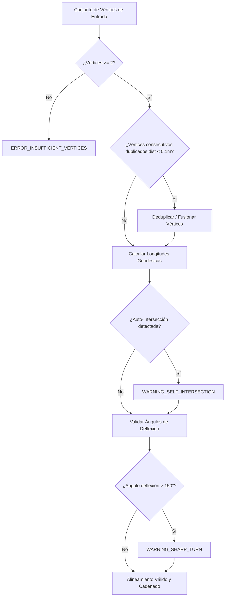

# SPEC-02: Trazo Geométrico y Alineamiento de Ejes Viales

- **ID:** SPEC-02
- **Módulo:** `pkg/tracer`
- **Estado:** `IMPLEMENTED` (Completado y verificado con 20 pruebas unitarias)
- **Dependencias:** Ninguna
- **Trazabilidad:** [Constitution - Module 2 & Principle 2](file:///d:/Projects/RoadSafetyScan/constitution.md#L51-L56)

---

## 1. Propósito y Alcance

Especificar la captura, cálculo geodésico, validación geométrica y modelado matemático del **eje o alineamiento vial de referencia**. 

El alineamiento es la base sobre la cual se calcula el cadenamiento longitudinal (abscisado o progresivas métricas) y la proyección ortogonal de los siniestros viales. Puede ser generado interactivamente por el usuario sobre el mapa o importado mediante archivos geoespaciales (GeoJSON, KML, GPX).

---

## 2. Definición Matemática y Estructuras de Datos

### 2.1 Modelo de Datos del Alineamiento (`Alignment`)

```typescript
export interface GeoCoordinate {
  longitude: number; // Grados decimales WGS84 [-180, 180]
  latitude: number;  // Grados decimales WGS84 [-90, 90]
  elevation?: number; // Metros sobre el nivel del mar (opcional)
}

export interface AlignmentVertex {
  index: number;
  coordinates: GeoCoordinate;
  cumulativeDistance: number; // Metros acumulados desde el inicio (S=0)
  stationFormatted: string;   // Notación MTC: 'km K+PPP.PP' (ej. 'km 12+350.50')
  segmentAzimuth?: number;    // Azimut geodésico en grados hacia el siguiente vértice [0, 360)
}

export interface AlignmentSegment {
  index: number;
  startVertex: AlignmentVertex;
  endVertex: AlignmentVertex;
  length: number;             // Longitud geodésica del segmento en metros
  azimuth: number;            // Azimut geodésico en grados [0, 360)
  bbox: { minX: number; minY: number; maxX: number; maxY: number };
}

export interface Alignment {
  id: string;
  name: string;
  vertices: AlignmentVertex[];
  segments: AlignmentSegment[];
  totalLength: number;        // Longitud total del eje en metros
  bbox: { minX: number; minY: number; maxX: number; maxY: number };
}
```

### 2.2 Formato de Notación de Progresiva Vial (Estándar MTC Perú)

La distancia longitudinal acumulada $S$ (en metros) se formatea de acuerdo con el *Manual de Carreteras: Diseño Geométrico (DG-2018)* del MTC:

$$\text{Estación} = \text{"km "} K + PPP.PP$$

Donde:
- $K = \lfloor S / 1000 \rfloor$ (kilómetros enteros).
- $PPP.PP = (S \pmod{1000})$ formateado con ceros a la izquierda y 2 decimales métricos:
  - Ejemplo: $S = 0 \text{ m} \rightarrow \text{"km 0+000.00"}$
  - Ejemplo: $S = 345.8 \text{ m} \rightarrow \text{"km 0+345.80"}$
  - Ejemplo: $S = 14520.12 \text{ m} \rightarrow \text{"km 14+520.12"}$

---

## 3. Algoritmos Geodésicos de Cadenamiento

### 3.1 Cálculo de Distancia Geodésica entre Vértices

Dado que el eje vial abarca distancias que pueden superar los $100\text{ km}$, el cálculo plano euclidiano directo sobre grados decimales $(\Delta \lambda, \Delta \phi)$ genera distorsiones inaceptables.

Se establece el uso de la **fórmula geodésica de Vincenty inversa** sobre el elipsoide WGS84, o como alternativa de baja latencia con precisión sub-métrica, la **fórmula del semiverseno (Haversine)** con radio medio terrestre de la IUGG ($R_E = 6,371,008.8\text{ m}$):

$$a = \sin^2\left(\frac{\Delta \phi}{2}\right) + \cos(\phi_1)\cos(\phi_2)\sin^2\left(\frac{\Delta \lambda}{2}\right)$$
$$c = 2 \cdot \text{atan2}\left(\sqrt{a}, \sqrt{1-a}\right)$$
$$d = R_E \cdot c$$

Para cada par de vértices consecutivos $v_k = (\lambda_k, \phi_k)$ y $v_{k+1} = (\lambda_{k+1}, \phi_{k+1})$:
- Longitud de segmento: $L_k = d(v_k, v_{k+1})$.
- Cadenamiento acumulado:
  $$C_0 = 0$$
  $$C_k = \sum_{j=0}^{k-1} L_j = C_{k-1} + L_{k-1} \quad (k \ge 1)$$

### 3.2 Azimut Geodésico de Orientación

El azimut inicial $\theta \in [0^\circ, 360^\circ)$ entre $v_k$ y $v_{k+1}$ se calcula como:

$$\theta = \text{atan2}\left(\sin(\Delta \lambda)\cos(\phi_{k+1}),\ \cos(\phi_k)\sin(\phi_{k+1}) - \sin(\phi_k)\cos(\phi_{k+1})\cos(\Delta \lambda)\right)$$
$$\theta_{\text{deg}} = (\theta \cdot 180 / \pi + 360) \pmod{360}$$

---

## 4. Fuentes de Captura y Mecanismos de Entrada

### 4.1 Trazo Interactivo sobre el Mapa (`Interactive Trace`)
- El usuario hace clic en el mapa para añadir vértices secuenciales $v_0, v_1, \dots, v_n$.
- Acciones permitidas:
  - **Añadir Vértice:** Clic izquierdo en lienzo.
  - **Deshacer (Undo):** Eliminación del último vértice mediante teclado (`Ctrl+Z` o `Esc`) o botón UI.
  - **Mover Vértice:** Arrastre (drag & drop) de vértices existentes con recálculo reactivo.
  - **Finalizar Trazo:** Doble clic o botón "Confirmar Eje".

### 4.2 Carga de Archivos de Alineamiento Externos
- **GeoJSON (`.geojson`, `.json`):**
  - Entidad de tipo `Feature<LineString>` o `Feature<MultiLineString>`.
  - Si es `MultiLineString`, el usuario debe seleccionar la línea principal o se concatena si los extremos coinciden dentro de un umbral de $1\text{ m}$.
- **GPX (`.gpx`):**
  - Extracción de puntos de trayectoria `<trkpt lat="..." lon="...">`.
- **KML (`.kml`):**
  - Extracción de elementos `<LineString><coordinates>...`.

---

## 5. Reglas de Validación Geométrica y Casos de Borde



1. **Vértices Mínimos:** Todo alineamiento debe contar con al menos 2 vértices no colapsados.
2. **Deduplicación de Vértices Adyacentes:** Si $d(v_k, v_{k+1}) < 0.10\text{ m}$, el vértice $v_{k+1}$ se fusiona silenciosamente para evitar singularidades matemáticas (división por cero en vectores de proyección).
3. **Detección de Auto-intersecciones:** Si dos segmentos no consecutivos se intersectan, se alerta al usuario indicando el tramo conflictivo, ya que esto provocaría ambigüedades en la proyección lineal de siniestros.
4. **Giros Cerrados (Deflexión Aguda):** Ángulos de deflexión mayores a $150^\circ$ entre segmentos adyacentes disparan una advertencia visual.

---

## 6. Rendimiento y Criterios de Aceptación (DoD)

### 6.1 Presupuesto de Rendimiento
- Creación y cadenamiento de un alineamiento de $2,000$ vértices ($150\text{ km}$) $\le 15\text{ ms}$.
- Renderizado de actualización en mapa tras mover un vértice $\le 16\text{ ms}$ (60 FPS).

### 6.2 Casos de Prueba Sintéticos (Unit Tests)

#### Test Case 2.1: Segmento Recto Norte-Sur
- **Given:** Vértices $v_0 = (-77.0000, -12.0000)$ y $v_1 = (-77.0000, -12.0090)$ (aprox. $1,000\text{ m}$ hacia el Sur).
- **When:** Se calcula el objeto `Alignment`.
- **Then:**
  - `totalLength` debe situarse dentro de $[995.0, 1005.0]\text{ m}$.
  - $v_0.\text{cumulativeDistance} == 0$.
  - $v_1.\text{stationFormatted}$ debe tener formato `"km 1+000.xx"`.
  - El azimut del segmento debe ser aproximadamente $180.0^\circ \pm 0.5^\circ$.

#### Test Case 2.2: Eliminación de Vértices Degenerados
- **Given:** 3 vértices donde $v_1$ y $v_2$ distan únicamente $0.02\text{ m}$.
- **When:** Se procesa el alineamiento.
- **Then:** El alineamiento resultante debe tener exactamente 2 vértices válidos y ninguna longitud de segmento igual o cercana a 0.

#### Test Case 2.3: Importación de Archivo GPX/KML
- **Given:** Un archivo GPX de prueba con 150 coordenadas de una carretera en la sierra central del Perú.
- **When:** Se invoca `parseGpxAlignment(xmlContent)`.
- **Then:** Se genera un `Alignment` válido con 150 vértices y progresiva acumulada monótona creciente.
