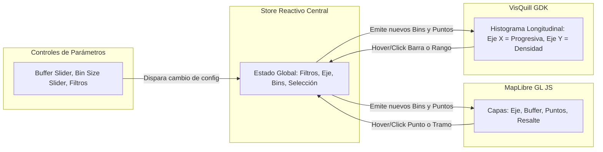

# SPEC-04: Perfilador Longitudinal Reactivo e Integración VisQuill

- **ID:** SPEC-04
- **Módulo:** `pkg/viz`
- **Estado:** `IMPLEMENTED` (Completado y verificado con pruebas unitarias del store reactivo y adaptadores)
- **Dependencias:** `SPEC-02` (Alineamiento vial), `SPEC-03` (Motor LRS)
- **Trazabilidad:** [Constitution - Module 4, Principle 4 & Tech Stack](file:///d:/Projects/RoadSafetyScan/constitution.md#L64-L73)

---

## 1. Propósito y Alcance

Especificar la capa de visualización interactiva y la sincronización reactiva bidireccional entre:
1. El **Mapa Espacial Cartográfico** (implementado en **MapLibre GL JS** con capas vectoriales).
2. El **Perfil Longitudinal de Densidad** (renderizado mediante **VisQuill GDK**).
3. El **Panel de Control Paramétrico** (filtros temporales, tipológicos, sliders de buffer y bin size).

La arquitectura garantiza una experiencia de usuario fluida a 60 FPS, permitiendo a los auditores viales detectar de forma instantánea tramos de concentración de accidentes ("puntos negros" o tramos críticos de concentración de siniestros).

---

## 2. Componentes de la Interfaz y Flujo de Interacción



---

## 3. Integración con VisQuill GDK

### 3.1 Configuración del Gráfico de Perfil Longitudinal

El perfil longitudinal mapea la progresiva continua de la carretera en el eje horizontal ($X$) y la magnitud de siniestralidad en el eje vertical ($Y$):

```typescript
export interface VisQuillProfileConfig {
  containerId: string;
  xAxis: {
    title: string;                 // 'Progresiva (km)'
    minChainage: number;           // 0
    maxChainage: number;           // Longitud total del eje (m)
    tickFormatter: (meters: number) => string; // Convierte metros a 'km K+PPP'
  };
  yAxis: {
    title: string;                 // 'N° de Siniestros / Bin' o 'Índice EPDO'
    metricMode: 'COUNT' | 'EPDO' | 'DENSITY_KM';
  };
  series: {
    type: 'stacked-bar' | 'area-gradient';
    colorMapping: Record<string, string>; // Colores estandarizados por severidad
  };
  interactions: {
    enableBrushZoom: boolean;
    enableCrosshair: boolean;
    tooltipTemplate: (bin: LrsBinAggregate) => string;
  };
}
```

### 3.2 Paleta de Colores de Seguridad Vial (Codificación Visual)

Para cumplir con criterios de accesibilidad visual y estándares internacionales de transporte:
- **Fatal (`FATAL`):** Rojo intenso `#DC2626` (alerta máxima).
- **Lesiones Graves (`LESIONES_GRAVES`):** Naranja ámbar `#EA580C`.
- **Lesiones Leves (`LESIONES_LEVES`):** Amarillo canario `#FACC15`.
- **Solo Daños (`SOLO_DANOS`):** Azul acero `#2563EB` o Gris azulado `#64748B`.
- **Faja de Buffer (Mapa):** Azul traslúcido `#0284C7` con opacidad $0.15$.
- **Resalte Activo (Hover / Selección):** Verde neón `#10B981` o Amarillo fluorescente `#EAB308`.

---

## 4. Contrato de Reactividad Bidireccional (Principio 4)

La sincronización entre el mapa y el perfil de VisQuill se orquesta a través de un bus de eventos / state store reactivo:

### 4.1 Escenario A: Interacción desde el Perfilador VisQuill $\rightarrow$ Mapa

```typescript
export interface BinHoverEvent {
  binIndex: number;
  startChainageMeters: number;
  endChainageMeters: number;
  crashes: ProjectedCrash[];
}
```

1. **Evento:** El usuario pasa el cursor sobre una barra del histograma en VisQuill (o arrastra para seleccionar un rango de cadenamiento).
2. **Respuesta en el Mapa (MapLibre GL JS):**
   - Se renderiza un segmento de línea resaltado (glow effect) sobre el alineamiento vial correspondiente exactamente a $[S_{\text{start}}, S_{\text{end}}]$.
   - Los marcadores de siniestros pertenecientes a dicho bin aumentan su radio en un $50\%$ y se destacan visualmente con un halo luminoso.
   - Si el tramo seleccionado está fuera de la vista actual del mapa, un control opcional permite hacer pan/zoom animado al tramo.

### 4.2 Escenario B: Interacción desde el Mapa $\rightarrow$ Perfilador VisQuill

```typescript
export interface CrashSelectEvent {
  crashId: string | number;
  chainageMeters: number;
}
```

1. **Evento:** El usuario posa el cursor o hace clic sobre un siniestro específico en el mapa.
2. **Respuesta en VisQuill GDK:**
   - La barra del bin que contiene la progresiva $S_i$ del siniestro se resalta con opacidad máxima, atenuando temporalmente las demás barras.
   - Una línea vertical indicadora (crosshair cursor) se fija en la progresiva exacta $S_i$.
   - Se despliega el tooltip contextual con detalles del siniestro: fecha, vehículos involucrados, tipo y severidad.

---

## 5. Panel de Control Paramétrico

El panel lateral proporciona controles reactivos con actualización en tiempo real:

1. **Slider de Ancho de Buffer ($W_{\text{buffer}}$):**
   - Rango: $5\text{ m}$ a $100\text{ m}$.
   - Paso (Step): $5\text{ m}$.
   - Valor inicial: $25\text{ m}$.
   - Efecto: Modifica el polígono de buffer en el mapa y re-ejecuta el filtrado LRS.
2. **Slider de Tamaño de Intervalo de Segmentación ($\Delta S$):**
   - Rango: $25\text{ m}$ a $500\text{ m}$.
   - Paso: $25\text{ m}$ o $50\text{ m}$.
   - Opciones precalibradas: $50\text{ m}$ (entorno urbano), $100\text{ m}$ (interurbano/carretera), $250\text{ m}$ (autopistas interprovinciales).
3. **Selector de Métrica Y:**
   - Opción 1: Conteo Total de Siniestros.
   - Opción 2: Siniestralidad Ponderada EPDO (Puntos Negros).
   - Opción 3: Tasa de Densidad (Siniestros / km).
4. **Filtros Categóricos y Temporales:**
   - Checkboxes de Severidad (Fatal, Grave, Leve, Solo Daños).
   - Multi-select de Tipología (Choque, Atropello, Despiste, etc.).
   - Rango de Años / Fechas.

---

## 6. Atribución y Licenciamiento de VisQuill GDK

En estricto cumplimiento de las directivas de la Constitución del Proyecto:
- La interfaz de usuario incluirá de forma permanente y visible en el pie del perfilador y en el diálogo "Acerca de" la atribución requerida para proyectos de código abierto:
  > *"Visualización de perfil longitudinal impulsada por VisQuill GDK."*
- Todo el código de integración se encapsulará en `pkg/viz` sin acoplamiento rígido, permitiendo emular o sustituir el motor de renderizado si fuere necesario para pruebas aisladas.

---

## 7. Rendimiento y Criterios de Aceptación (DoD)

### 7.1 Presupuesto de Rendimiento
- Despacho y renderizado del evento hover bidireccional $\le 16\text{ ms}$ (sin tirones / lag perceptible).
- Renderizado inicial del perfil de VisQuill para un eje con $500$ bins $\le 30\text{ ms}$.

### 7.2 Casos de Prueba de Interacción

#### Test Case 4.1: Sincronización Hover Profile $\rightarrow$ Map
- **Given:** Un perfil con 20 bins renderizado.
- **When:** Se dispara el evento `onBinHover(binIndex: 4)`.
- **Then:** El estado global emite `ACTIVE_RANGE = [400m, 500m]`; la capa de resalte en MapLibre recibe las coordenadas de ese subtramo exacto.

#### Test Case 4.2: Filtro Dinámico de Severidad
- **Given:** Un dataset con 10 siniestros fatales y 40 solo daños.
- **When:** El usuario desmarca el checkbox "Solo Daños".
- **Then:** El histograma de VisQuill debe re-escalar el eje Y mostrando únicamente los 10 siniestros fatales; los puntos de "Solo Daños" en el mapa se ocultan o pasan a opacidad reducida.
