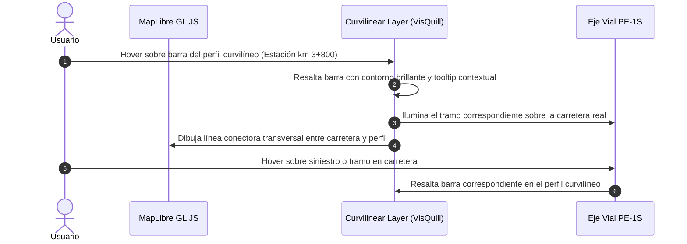

# SPEC-06: Perfil Curvilíneo Paralelo al Trazo ("Profiles along a line" - VisQuill Paradigm)

- **ID:** SPEC-06
- **Módulo:** `pkg/viz` / `pkg/curvilinear`
- **Estado:** `IMPLEMENTED` (100% de Pruebas Verificadas y Compilación de Producción Exitosa)
- **Referencia Visual:** [Imagen de Referencia VisQuill A1 Collision Density](file:///C:/Users/W11/.gemini/antigravity/brain/f622afdf-7999-4a6a-87bd-c304243b6a01/.user_uploaded/media_1791859504716_69041d96.png)
- **Trazabilidad:** [Constitution - Principle 4 & Module 4](file:///d:/Projects/RoadSafetyScan/constitution.md#L29-L33)

---

## 1. Declaración del Problema y Cambio de Paradigma

### 1.1 Corrección Conceptual
En la implementación preliminar, el perfil longitudinal se concibió como un gráfico cartesiano 2D tradicional ($X-Y$) ubicado en un panel separado en la parte inferior de la pantalla.

**El objetivo real del proyecto y del paradigma VisQuill GDK ("Profiles along a line"):**
El perfil de siniestralidad **no es un gráfico cartesiano plano separado**, sino un **diagrama cartográfico curvilíneo renderizado directamente sobre el mapa**, el cual:
1. **Preserva la forma y curvatura del trazo vial:** Se genera una línea base (baseline) paralela a la carretera, desplazada espacialmente a una distancia lateral configurable ($D_{\text{offset}}$).
2. **Extrusión ortogonal de barras:** Desde la baseline desplazada, las barras del histograma emergen de forma perpendicular (a lo largo del vector normal $\vec{n}(s)$ en cada progresiva), manteniendo la morfología geográfica del corredor.
3. **Isolíneas concéntricas de escala:** Se trazan curvas guía paralelas a diferentes magnitudes de siniestralidad (ej. marcas de escala $225, 450, 675, 900$) que siguen la misma curvatura del perfil.
4. **Controles interactivos integrados (Pills):** Pastillas de control flotantes sobre la propia baseline para cambiar métricas, lados de proyección o filtrar severidades.

---

## 2. Modelo Matemático y Geométrico

```
            Carretera Real T(s)
                 ╭──────────╮
            ─────╯          ╰─────────────►
                   │
                   │ Vector de Offset D_offset * n(s)
                   ▼
              Línea Base del Perfil B(s)
                 ╭──────────╮
            ─────╯          ╰─────────────►
                 │   │ │  │ │   │
                 │ █ │ █  │ █   │ █ ◄── Barras del Histograma (Extrusión Normal)
            ─────┼───┼─┼──┼─┼───┼───┼─────► Isolínea de Escala 1 (ej. 25 siniestros)
                 │   │ │  │ │   │   │
            ─────┼───┼─┼──┼─┼───┼───┼─────► Isolínea de Escala 2 (ej. 50 siniestros)
```

### 2.1 Trayectoria Base y Vector Normal

Dada la polilínea del eje vial $T(s)$ parametrizada por su longitud de arco acumulada $s \in [0, L_{\text{total}}]$, con vector tangente unitario $\vec{\tau}(s) = (\tau_x, \tau_y)$:

El vector normal unitario transversal $\vec{n}(s)$ en el plano proyectado se define como:
$$\vec{n}(s) = (-\tau_y,\ \tau_x)$$

Para un desplazamiento hacia el margen derecho, $\vec{n}_{\text{dir}}(s) = \vec{n}(s)$; para el margen izquierdo, $\vec{n}_{\text{dir}}(s) = -\vec{n}(s)$.

### 2.2 Suavizado de la Línea Base del Perfil (Offset Baseline Smoothing)

Si el eje vial original $T(s)$ presenta quiebres angulares bruscos o ruido de alta frecuencia, una curva paralela simple $T(s) + D_{\text{offset}} \cdot \vec{n}(s)$ generaría intersecciones internas (bucles de auto-colisión).

Para garantizar la estética y legibilidad del paradigma VisQuill:
1. Se calcula una versión suavizada del vector normal o de la trayectoria mediante un filtro Gaussiano / Laplaciano:
   $$\vec{n}_{\text{smooth}}(s_i) = \frac{1}{\sum w_j} \sum_{j=-m}^{m} w_j \cdot \vec{n}(s_{i+j})$$
2. La línea base de referencia para el perfil $B(s)$ se obtiene como:
   $$B(s) = T(s) + D_{\text{offset}} \cdot \vec{n}_{\text{smooth}}(s)$$
3. Se verifica que $B(s)$ sea localmente biyectiva con $T(s)$, preservando la misma correspondencia métrica de progresiva $s$.

### 2.3 Geometría de los Cuadriláteros del Histograma (Transect Bars)

Para cada bin $k$ correspondiente al intervalo de progresiva $[s_k, s_{k+1}]$ con tamaño de segmento $\Delta s$:
- **Puntos base sobre la baseline:**
  $$P_{k, \text{start}} = B(s_k), \quad P_{k, \text{end}} = B(s_{k+1})$$
- **Magnitud del histograma:** $M_k$ (conteo de siniestros, EPDO o tasa de densidad).
- **Longitud espacial de la barra:**
  $$H_k = M_k \cdot K_{\text{scale}}$$
  *(Donde $K_{\text{scale}}$ es el factor de conversión de valor de siniestros a metros/pixels en el lienzo cartográfico).*
- **Puntos exteriores de la barra:**
  $$Q_{k, \text{start}} = P_{k, \text{start}} + H_k \cdot \vec{n}_{\text{ext}}(s_k)$$
  $$Q_{k, \text{end}} = P_{k, \text{end}} + H_k \cdot \vec{n}_{\text{ext}}(s_{k+1})$$
- **Geometría del Polígono:** Polígono cerrado formado por los 4 vértices:
  $$\text{BarPoly}_k = [P_{k, \text{start}},\ Q_{k, \text{start}},\ Q_{k, \text{end}},\ P_{k, \text{end}},\ P_{k, \text{start}}]$$

### 2.4 Generación de Isolíneas de Escala Curvilíneas (Scale Gridlines)

Para un conjunto de valores de referencia graduados $V_j \in \{V_1, V_2, \dots, V_N\}$ (ej. $225, 450, 675, 900$):
- La curva de referencia correspondiente a $V_j$ se genera evaluando:
  $$\text{GridLine}_j(s) = B(s) + (V_j \cdot K_{\text{scale}}) \cdot \vec{n}_{\text{ext}}(s) \quad \forall s \in [0, L_{\text{total}}]$$
- Se intercalan rayos transversales en los extremos y a intervalos kilométricos regulares que unen la baseline $B(s)$ con la isolínea exterior máxima.

---

## 3. Especificación de Tipos e Interfaces TypeScript

```typescript
export interface CurvilinearProfileOptions {
  /** Desplazamiento lateral de la línea base respecto al eje vial en metros (ej. 1500m) */
  offsetDistanceMeters: number;
  
  /** Lado de proyección respecto al sentido de avance del eje */
  side: 'LEFT' | 'RIGHT';
  
  /** Factor de escala de altura de barra (metros de dibujo por unidad de valor) */
  heightScaleMetersPerUnit: number;
  
  /** Valores para las isolíneas de escala concéntricas */
  scaleTicks: number[]; // ej. [25, 50, 75, 100] o [225, 450, 675, 900]
  
  /** Parámetro de suavizado de la normal (radio de ventana en vértices) */
  smoothingWindowSize?: number;
}

export interface CurvilinearBarFeature {
  binIndex: number;
  startChainageMeters: number;
  endChainageMeters: number;
  startStationFormatted: string;
  endStationFormatted: string;
  value: number;
  heightMeters: number;
  polygonCoordinates: [longitude: number, latitude: number][];
  severityBreakdown?: Record<string, number>;
}

export interface CurvilinearIsolineFeature {
  tickValue: number;
  heightMeters: number;
  lineCoordinates: [longitude: number, latitude: number][];
  labelPosition: [longitude: number, latitude: number];
  labelRotationDegrees: number;
}

export interface CurvilinearProfileModel {
  alignmentId: string;
  baselineCoordinates: [longitude: number, latitude: number][];
  bars: CurvilinearBarFeature[];
  isolines: CurvilinearIsolineFeature[];
  connectorLines?: [longitude: number, latitude: number][][];
}
```

---

## 4. Experiencia de Usuario e Interacción Bidireccional



### 4.1 Controles Flotantes Sobre la Línea Base (Pill Controls)
Directamente sobre la curva base $B(s)$ se sitúan pastillas de control interactivas:
1. **Pill de Métrica:** Alterna entre *Conteo Total*, *Índice EPDO* y *Densidad/km*.
2. **Pill de Lado / Orientación:** Alterna la proyección del perfil entre el lado Este (Derecha) u Oeste (Izquierda).
3. **Handle de Arrastre de Offset:** Permite al usuario arrastrar el perfil para alejarlo o acercarlo a la carretera según la densidad geográfica de la zona.

---

## 5. Arquitectura de Renderizado en MapLibre GL JS

Para garantizar 60 FPS, soporte de zoom/pan sin desfase y renderizado nítido:
1. **Generación GeoJSON en Coordenadas WGS84:**
   - La baseline $B(s)$, los polígonos de barras `BarPoly_k` y las isolíneas se calculan en coordenadas geodésicas $(\text{lon}, \text{lat})$ y se alimentan a fuentes `GeoJSONSource` nativas de MapLibre.
2. **Capas Visuales en el Mapa:**
   - `layer-curvilinear-baseline`: Línea guía de anclaje (estilo sutil `#475569`).
   - `layer-curvilinear-bars-fill`: Relleno de las barras (`fill-color: #7C3AED` o según severidad MTC).
   - `layer-curvilinear-bars-stroke`: Bordes nítidos de las barras (`fill-outline-color`).
   - `layer-curvilinear-isolines`: Líneas finas concéntricas de escala con etiquetas de texto orientadas.
   - `layer-curvilinear-active-highlight`: Resalte de barra activa y segmento de carretera correspondiente.

---

## 6. Criterios de Aceptación (Definition of Done)

### 6.1 Presupuesto de Rendimiento
- Generación de la geometría completa del perfil curvilíneo (100 bins + 4 isolíneas) $\le 20\text{ ms}$.
- Actualización fluida al modificar la distancia de offset o el tamaño de bin $\le 25\text{ ms}$.

### 6.2 Casos de Prueba Sintéticos (Unit & Integration Tests)

#### Test Case 6.1: Generación de Línea Base Paralela Desplazada
- **Given:** Un eje recto Sur-Norte de $1,000\text{ m}$.
- **When:** Se genera la baseline con $D_{\text{offset}} = 500\text{ m}$ hacia la derecha (Este).
- **Then:**
  - Cada vértice de la baseline debe distar exactamente $500\text{ m} \pm 1\text{ m}$ del eje original.
  - La longitud total de la baseline debe coincidir con la del eje original.

#### Test Case 6.2: Extrusión Ortogonal de Barras del Histograma
- **Given:** Un bin en el cadenamiento $s = 200\text{ m}$ con valor de siniestros = 10 y factor de escala = $20\text{ m/siniestro}$.
- **When:** Se calcula el polígono de la barra.
- **Then:**
  - La distancia entre la base y el extremo superior de la barra debe ser exactamente $200\text{ m}$.
  - El vector de protrusión debe ser estrictamente perpendicular a la tangente local de la baseline.

#### Test Case 6.3: Isolíneas Concéntricas de Escala
- **Given:** Ticks de escala $[25, 50, 75, 100]$.
- **When:** Se generan las isolíneas.
- **Then:** Se obtienen exactamente 4 geometrías `LineString` concéntricas y continuas que siguen la curvatura del corredor.
