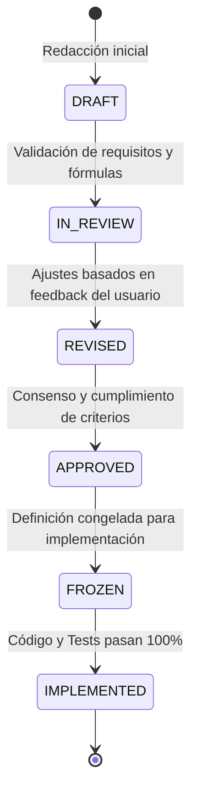

# Especificaciones Técnicas (Specs) - RoadSafetyScan

## 1. Marco Metodológico: Spec-Driven Development (SDD)

El proyecto **RoadSafetyScan** se rige de manera estricta por los principios de **Spec-Driven Development (SDD)** establecidos en la [Constitución del Proyecto](file:///d:/Projects/RoadSafetyScan/constitution.md). 

Bajo este marco metodológico:
1. **Spec-First:** Ningún componente algorítmico, geométrico, visual o de exportación puede implementarse en código ejecutable sin contar previamente con su especificación técnica formal aprobada y congelada (`FROZEN`).
2. **Trazabilidad Bidireccional:** Todo requisito funcional en un spec cuenta con un conjunto unívoco de pruebas unitarias (`tests/unit/`) y pruebas de integración (`tests/integration/`).
3. **Local-First & Client-Side:** Todas las transformaciones geométricas y análisis estadísticos deben ser ejecutables en el navegador web del usuario final (ingenieros y analistas de entidades públicas como MTC, SUTRAN, ATU, Gobiernos Regionales y Municipalidades), sin dependencias en servicios de backend propietarios.
4. **Reproducibilidad Científica:** Todo cálculo matemático geodésico y de referenciación lineal (LRS) debe estar matemáticamente fundamentado y parametrizado con tolerancias métricas explícitas.

---

## 2. Índice de Especificaciones del Sistema

| ID | Módulo | Archivo de Especificación | Componente / Paquete | Estado |
| :--- | :--- | :--- | :--- | :--- |
| **SPEC-01** | Ingesta & Indexación Espacial | [`specs/01-data-ingestion-indexing.md`](file:///d:/Projects/RoadSafetyScan/specs/01-data-ingestion-indexing.md) | `pkg/data` | `STANDBY` (Mocked) |
| **SPEC-02** | Trazo Geométrico & Alineamiento | [`specs/02-geometric-trace-alignment.md`](file:///d:/Projects/RoadSafetyScan/specs/02-geometric-trace-alignment.md) | `pkg/tracer` | `IMPLEMENTED` (100% Tests Pass) |
| **SPEC-04** | Perfilador Cartesiano Separado (Legacy) | [`specs/04-reactive-visualization-profiler.md`](file:///d:/Projects/RoadSafetyScan/specs/04-reactive-visualization-profiler.md) | `pkg/viz` | `SUPERSEDED` por SPEC-06 |
| **SPEC-05** | Exportación & Interoperabilidad | [`specs/05-export-interoperability.md`](file:///d:/Projects/RoadSafetyScan/specs/05-export-interoperability.md) | `pkg/export` | `IMPLEMENTED` (100% Tests Pass) |
| **SPEC-06** | Perfil Curvilíneo Paralelo ("Profiles along a line") | [`specs/06-curvilinear-profile-along-line.md`](file:///d:/Projects/RoadSafetyScan/specs/06-curvilinear-profile-along-line.md) | `pkg/viz` / `pkg/curvilinear` | `IMPLEMENTED` (100% Tests Pass) |
| **SPEC-15** | Herramienta de Trazo, Almacenamiento GTFS/.txt y Rutas Activas | [`specs/15-interactive-trace-drawing-and-gtfs-storage.md`](file:///d:/Projects/RoadSafetyScan/specs/15-interactive-trace-drawing-and-gtfs-storage.md) | `pkg/tracer` / `pkg/export` / `ui` | `COMPLETADO (IMPLEMENTED)` |
| **SPEC-16** | Pulido Visual, Contraste Accesible y Modos Claro / Oscuro | [`specs/16-ui-polishing-accessibility-and-theme-harmonization.md`](file:///d:/Projects/RoadSafetyScan/specs/16-ui-polishing-accessibility-and-theme-harmonization.md) | `ui` / `styles` / `theme` | `COMPLETADO (IMPLEMENTED)` |
| **SPEC-17** | Barras Curvilíneas Apiladas por Gravedad de Personas | [`specs/17-map-curvilinear-stacked-persons-by-severity.md`](file:///d:/Projects/RoadSafetyScan/specs/17-map-curvilinear-stacked-persons-by-severity.md) | `pkg/curvilinear` / `ui` | `COMPLETADO (IMPLEMENTED)` |
| **SPEC-18** | Guía de Inicio Rápido y Documentación del Proyecto (README.md) | [`specs/18-project-documentation-and-deployment-guide.md`](file:///d:/Projects/RoadSafetyScan/specs/18-project-documentation-and-deployment-guide.md) | `docs` / `README.md` | `COMPLETADO (IMPLEMENTED)` |

---

## 3. Matriz de Trazabilidad (Constitución $\rightarrow$ Especificación)

| Sección de la Constitución | Principio / Alcance | Especificación Relacionada |
| :--- | :--- | :--- |
| **Principle 1** | Gobernanza Spec-First | [`specs/README.md`](file:///d:/Projects/RoadSafetyScan/specs/README.md) (Normativa y Plantilla) |
| **Principle 2 & Module 1** | Procesamiento Client-Side & Ingesta | [`specs/01-data-ingestion-indexing.md`](file:///d:/Projects/RoadSafetyScan/specs/01-data-ingestion-indexing.md) |
| **Module 2** | Trazo, Importación y Cadenamiento | [`specs/02-geometric-trace-alignment.md`](file:///d:/Projects/RoadSafetyScan/specs/02-geometric-trace-alignment.md) |
| **Principle 3 & Module 3** | Proyección LRS, Buffer y Agregación | [`specs/03-lrs-projection-engine.md`](file:///d:/Projects/RoadSafetyScan/specs/03-lrs-projection-engine.md) |
| **Principle 4 & Module 4** | Perfil Curvilíneo en Mapa ("Profiles along a line") | [`specs/06-curvilinear-profile-along-line.md`](file:///d:/Projects/RoadSafetyScan/specs/06-curvilinear-profile-along-line.md) |
| **Principle 5 & Module 5** | Formatos Abiertos y Exportación | [`specs/05-export-interoperability.md`](file:///d:/Projects/RoadSafetyScan/specs/05-export-interoperability.md) |

---

## 4. Ciclo de Vida de una Especificación (Spec Lifecycle)

1. **DRAFT:** Borrador técnico en elaboración.
2. **IN_REVIEW:** Listo para revisión por el auditor/usuario líder.
3. **REVISED:** Ajustado con observaciones o requisitos complementarios.
4. **APPROVED:** Aprobado formalmente; no se admiten cambios estructurales sin RFC.
5. **FROZEN:** Congelado. Se habilita la fase de codificación TDD (Test-Driven Development).
6. **IMPLEMENTED:** Todos los criterios de aceptación y tests sintéticos son verificados exitosamente.
