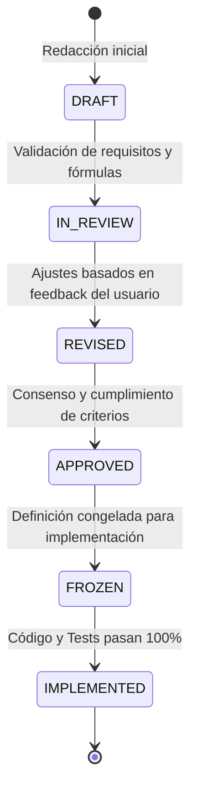

# Especificaciones Técnicas (Specs) - RoadSafetyScan

## 1. Marco Metodológico: Spec-Driven Development (SDD)

El proyecto **RoadSafetyScan** se rige de manera estricta por los principios de **Spec-Driven Development (SDD)** establecidos en la [Constitución del Proyecto](file:///d:/Projects/RoadSafetyScan/constitution.md). 

Bajo este marco metodológico:
1. **Spec-First:** Ningún componente algorítmico, geométrico, visual o de exportación puede implementarse en código ejecutable sin contar previamente con su especificación técnica formal aprobada y congelada (`FROZEN`).
2. **Trazabilidad Bidireccional:** Todo requisito funcional en un spec cuenta con un conjunto unívoco de pruebas unitarias (`tests/unit/`) y pruebas de integración (`tests/integration/`).
3. **Local-First & Client-Side:** Todas las transformaciones geométricas y análisis estadísticos deben ser ejecutables en el navegador web del usuario final (ingenieros y analistas de entidades públicas como MTC, SUTRAN, ATU, Gobiernos Regionales y Municipalidades), sin dependencias en servicios de backend propietarios.
4. **Reproducibilidad Científica:** Todo cálculo matemático geodésico y de referenciación lineal (LRS) debe estar matemáticamente fundamentado y parametrizado con tolerancias métricas explícitas.

---

## 2. Índice Completo de Especificaciones del Sistema

| ID | Módulo | Archivo de Especificación | Componente / Paquete | Conceptos Clave & Métricas | Estado |
| :--- | :--- | :--- | :--- | :--- | :--- |
| **SPEC-01** | Ingesta & Indexación Espacial | [`specs/01-data-ingestion-indexing.md`](file:///d:/Projects/RoadSafetyScan/specs/01-data-ingestion-indexing.md) | `pkg/data` | Parseo GeoJSON, Bounding Boxes, R-Tree | `STANDBY` (Mocked) |
| **SPEC-02** | Trazo Geométrico & Alineamiento | [`specs/02-geometric-trace-alignment.md`](file:///d:/Projects/RoadSafetyScan/specs/02-geometric-trace-alignment.md) | `pkg/tracer` | Cadenamiento Geodésico, Interpolación WGS84 | `IMPLEMENTED` (100% Tests Pass) |
| **SPEC-03** | Motor LRS, Buffer, EPDO & Densidad | [`specs/03-lrs-projection-engine.md`](file:///d:/Projects/RoadSafetyScan/specs/03-lrs-projection-engine.md) | `pkg/lrs` | **Índice EPDO (MTC)**, **Densidad por km**, Proyección Ortogonal, Buffer | `IMPLEMENTED` (100% Tests Pass) |
| **SPEC-04** | Perfilador Cartesiano Separado (Legacy) | [`specs/04-reactive-visualization-profiler.md`](file:///d:/Projects/RoadSafetyScan/specs/04-reactive-visualization-profiler.md) | `pkg/viz` | Gráfico X-Y inferior tradicional | `SUPERSEDED` por SPEC-06 |
| **SPEC-05** | Exportación & Interoperabilidad | [`specs/05-export-interoperability.md`](file:///d:/Projects/RoadSafetyScan/specs/05-export-interoperability.md) | `pkg/export` | CSV con **`indice_epdo`** y **`densidad_por_km`**, GeoJSON LRS | `IMPLEMENTED` (100% Tests Pass) |
| **SPEC-06** | Perfil Curvilíneo Paralelo ("Profiles along a line") | [`specs/06-curvilinear-profile-along-line.md`](file:///d:/Projects/RoadSafetyScan/specs/06-curvilinear-profile-along-line.md) | `pkg/viz` / `pkg/curvilinear` | **VisQuill A1 Collision Density**, Extrusión Normal, Isolíneas | `IMPLEMENTED` (100% Tests Pass) |
| **SPEC-07** | Diagnóstico de Capas Cartográficas | [`specs/07-map-layer-rendering-diagnostics.md`](file:///d:/Projects/RoadSafetyScan/specs/07-map-layer-rendering-diagnostics.md) | `pkg/viz` | Renderizado Robusto MapLibre GL | `IMPLEMENTED` |
| **SPEC-08** | Visibilidad Dinámica de Puntos por Zoom | [`specs/08-crash-points-zoom-visibility.md`](file:///d:/Projects/RoadSafetyScan/specs/08-crash-points-zoom-visibility.md) | `pkg/viz` | Umbral de visibilidad de clusters vs puntos | `IMPLEMENTED` |
| **SPEC-09** | Límites de Zoom & Autoescala | [`specs/09-zoom-limits-and-autoscale.md`](file:///d:/Projects/RoadSafetyScan/specs/09-zoom-limits-and-autoscale.md) | `pkg/viz` | Autoescala vertical de histogramas | `IMPLEMENTED` |
| **SPEC-10** | Filtro Temporal Circular Horario | [`specs/10-circular-time-range-clock.md`](file:///d:/Projects/RoadSafetyScan/specs/10-circular-time-range-clock.md) | `ui` | Reloj circular 24h interactivo | `IMPLEMENTED` |
| **SPEC-11** | Puntero Interactivo Bidireccional | [`specs/11-interactive-chainage-pointer.md`](file:///d:/Projects/RoadSafetyScan/specs/11-interactive-chainage-pointer.md) | `ui` / `pkg/curvilinear` | Cursillete Eje $\leftrightarrow$ Perfil Longitudinal | `IMPLEMENTED` |
| **SPEC-12** | Asa Interactiva de Escala de Barras | [`specs/12-interactive-scale-handle.md`](file:///d:/Projects/RoadSafetyScan/specs/12-interactive-scale-handle.md) | `ui` / `pkg/curvilinear` | Escalado dinámico en mapa | `IMPLEMENTED` |
| **SPEC-13** | Filtro Temporal Multianual | [`specs/13-annual-temporal-filter.md`](file:///d:/Projects/RoadSafetyScan/specs/13-annual-temporal-filter.md) | `ui` / `pkg/data` | Selección múltiple de años 2021-2025 | `IMPLEMENTED` |
| **SPEC-14** | BBDD ONSV, Vehículos, Personas & EPDO | [`specs/14-database-integration-and-severity-profiling.md`](file:///d:/Projects/RoadSafetyScan/specs/14-database-integration-and-severity-profiling.md) | `pkg/data` / `pkg/lrs` / `ui` | SQLite3 ONSV, Dimensiones (Siniestros, Vehículos, Personas, **EPDO**), Hotspot | `IMPLEMENTED` (100% Tests Pass) |
| **SPEC-15** | Herramienta de Trazo, GTFS & Rutas Activas | [`specs/15-interactive-trace-drawing-and-gtfs-storage.md`](file:///d:/Projects/RoadSafetyScan/specs/15-interactive-trace-drawing-and-gtfs-storage.md) | `pkg/tracer` / `pkg/export` / `ui` | Trazo en mapa, Exportación GTFS `routes.txt`/`shapes.txt`, selector de rutas | `IMPLEMENTED` (100% Tests Pass) |
| **SPEC-16** | Pulido Visual, Contraste Accesible & Temas | [`specs/16-ui-polishing-accessibility-and-theme-harmonization.md`](file:///d:/Projects/RoadSafetyScan/specs/16-ui-polishing-accessibility-and-theme-harmonization.md) | `ui` / `styles` / `theme` | WCAG 2.1 AA, Contraste en Modo Claro / Oscuro | `IMPLEMENTED` (100% Tests Pass) |
| **SPEC-17** | Barras Curvilíneas Apiladas por Gravedad | [`specs/17-map-curvilinear-stacked-persons-by-severity.md`](file:///d:/Projects/RoadSafetyScan/specs/17-map-curvilinear-stacked-persons-by-severity.md) | `pkg/curvilinear` / `ui` | Barras apiladas (Fallecido, Lesionado, No se conoce, Ileso) | `IMPLEMENTED` (100% Tests Pass) |
| **SPEC-18** | Guía de Inicio Rápido & Documentación | [`specs/18-project-documentation-and-deployment-guide.md`](file:///d:/Projects/RoadSafetyScan/specs/18-project-documentation-and-deployment-guide.md) | `docs` / `README.md` | Guía de instalación, BBDD ONSV MTC, Paso a Paso | `IMPLEMENTED` (100% Tests Pass) |
| **SPEC-19** | Límites Dinámicos de Zoom & Navegación Perú | [`specs/19-dynamic-zoom-limits-and-free-peru-navigation.md`](file:///d:/Projects/RoadSafetyScan/specs/19-dynamic-zoom-limits-and-free-peru-navigation.md) | `ui/map-view` / `pkg/tracer` | Zoom mínimo dinámico (Zoom 4 libre sin ruta activa) | `IMPLEMENTED` (100% Tests Pass) |
| **SPEC-20** | Anti-Knot & Suavizado de Curvas Cerradas | [`specs/20-anti-knot-offset-smoothing-and-curvature-regularization.md`](file:///d:/Projects/RoadSafetyScan/specs/20-anti-knot-offset-smoothing-and-curvature-regularization.md) | `pkg/curvilinear` | Desenredo de Bucles en "X", Suavizado Gaussiano | `IMPLEMENTED` (100% Tests Pass) |
| **SPEC-21** | Edición Interactiva & Bloqueo de Trazos | [`specs/21-trace-locking-and-interactive-editing.md`](file:///d:/Projects/RoadSafetyScan/specs/21-trace-locking-and-interactive-editing.md) | `pkg/tracer` / `ui` | Bloqueo 🔒, Aviso Modal de Seguridad, Arrastre de Vértices | `IMPLEMENTED` (100% Tests Pass) |
| **SPEC-22** | Visualización de Faja de Influencia (Buffer) | [`specs/22-interactive-buffer-corridor-visualization.md`](file:///d:/Projects/RoadSafetyScan/specs/22-interactive-buffer-corridor-visualization.md) | `pkg/tracer` / `ui/map-view` | Polígono Tenue de Buffer, Reactividad al Slider | `IMPLEMENTED` (100% Tests Pass) |
| **SPEC-23** | Recorte al Viewport & Segmentación Dinámica por Zoom | [`specs/23-dynamic-viewport-clipping-and-zoom-adaptive-segmentation.md`](file:///d:/Projects/RoadSafetyScan/specs/23-dynamic-viewport-clipping-and-zoom-adaptive-segmentation.md) | `pkg/curvilinear` / `ui/map-view` | Recorte a Pantalla, Mínimo 100m, Segmentación Dinámica | `IMPLEMENTED` (100% Tests Pass) |
| **SPEC-24** | Mapeo por Longitud de Arco & Barras Inalteradas | [`specs/24-visquill-arc-length-baseline-mapping-and-distortionless-bars.md`](file:///d:/Projects/RoadSafetyScan/specs/24-visquill-arc-length-baseline-mapping-and-distortionless-bars.md) | `pkg/curvilinear` / `ui/map-view` | Mapeo por Desplazamiento VisQuill, Anclaje en Baseline, Supresión de Cero | `IMPLEMENTED` (100% Tests Pass) |
| **SPEC-25** | Segmentación Fija a 100m & Ancho Uniforme | [`specs/25-fixed-100m-segmentation-and-uniform-bar-widths.md`](file:///d:/Projects/RoadSafetyScan/specs/25-fixed-100m-segmentation-and-uniform-bar-widths.md) | `pkg/curvilinear` / `ui/map-view` | Bins de 100m Constantes, Ancho Uniforme, Tramos Vacíos | `IMPLEMENTED` (100% Tests Pass) |
| **SPEC-26** | Constreñimiento 1D del Puntero en Línea Base | [`specs/26-1d-baseline-constrained-pointer-slider.md`](file:///d:/Projects/RoadSafetyScan/specs/26-1d-baseline-constrained-pointer-slider.md) | `pkg/curvilinear` / `ui/map-view` | Puntero Riel 1D, Anclado a Línea Base Offset, Sin Despegue | `IMPLEMENTED` (100% Tests Pass) |
| **SPEC-27** | Mapeo Local Estacionado & Desviación Acotada | [`specs/27-local-station-coordinated-baseline-mapping.md`](file:///d:/Projects/RoadSafetyScan/specs/27-local-station-coordinated-baseline-mapping.md) | `pkg/curvilinear` / `ui/map-view` | Vínculo Local $s \mapsto B(s)$, Desviación $\le 25\text{m}$, Conector Ortogonal | `IMPLEMENTED` (100% Tests Pass) |
| **SPEC-28** | Grilla Cuádruple Fija & Botón de Escala Confinado | [`specs/28-4-scale-grid-and-constrained-scale-handle.md`](file:///d:/Projects/RoadSafetyScan/specs/28-4-scale-grid-and-constrained-scale-handle.md) | `pkg/curvilinear` / `ui/map-view` | 4 Escalas Concéntricas, Handle en Nivel 1 por Defecto, Confinamiento 1D a Grilla | `IMPLEMENTED` (100% Tests Pass) |
| **SPEC-29** | Ocultamiento Colapsable de Leyenda Cartográfica y Panel Lateral | [`specs/29-collapsible-legend-and-sidebar.md`](file:///d:/Projects/RoadSafetyScan/specs/29-collapsible-legend-and-sidebar.md) | `ui` / `styles` | Colapso de Leyenda, Sidebar Plegable, Redimensionamiento MapLibre | `IMPLEMENTED` (100% Tests Pass) |
| **SPEC-30** | Ocultamiento Colapsable de la Barra Superior de Métricas | [`specs/30-collapsible-floating-metrics-bar.md`](file:///d:/Projects/RoadSafetyScan/specs/30-collapsible-floating-metrics-bar.md) | `ui` / `styles` | Barra Flotante Colapsable, Píldora de Métrica Activa, Despeje de Mapa | `IMPLEMENTED` (100% Tests Pass) |
| **SPEC-31** | Línea Base Rectilínea & Barras Ortogonales Limpias | [`specs/31-rectilinear-macro-baseline-and-orthogonal-bars.md`](file:///d:/Projects/RoadSafetyScan/specs/31-rectilinear-macro-baseline-and-orthogonal-bars.md) | `pkg/curvilinear` / `ui/map-view` | Paradigma VisQuill Eje Rectilíneo, Barras Paralelas, Grilla Recta | `IMPLEMENTED` (100% Tests Pass) |
| **SPEC-32** | Línea Base Global Estable con Bordes Curvos | [`specs/32-stable-baseline-curved-transitions-anti-rotation.md`](file:///d:/Projects/RoadSafetyScan/specs/32-stable-baseline-curved-transitions-anti-rotation.md) | `pkg/curvilinear` / `ui/map-view` | Garantía Antigiro, Arcos en Bordes, Estabilidad Global de Trazado | `IMPLEMENTED` (100% Tests Pass) |
| **SPEC-33** | Alineación de Controles Duales & Seguimiento a la Mira | [`specs/33-aligned-controls-viewport-sight-tracking.md`](file:///d:/Projects/RoadSafetyScan/specs/33-aligned-controls-viewport-sight-tracking.md) | `ui/map-view` / `pkg/curvilinear` | Alineación Coaxial Puntero-Escala, Seguimiento a la Mira en Paneo | `IMPLEMENTED` (100% Tests Pass) |
| **SPEC-34** | Bordes Curvos Invariables hacia el Lado Opuesto de las Barras | [`specs/34-viewport-curved-ends-and-counter-bar-deflection.md`](file:///d:/Projects/RoadSafetyScan/specs/34-viewport-curved-ends-and-counter-bar-deflection.md) | `pkg/curvilinear` / `ui/map-view` | Curvatura Terminal Cóncava en Cualquier Zoom, Deflexión Anti-Barras, Distancia Controlada | `IMPLEMENTED` (100% Tests Pass) |
| **SPEC-35** | Despeje Geométrico Anti-Superposición & Offset Dinámico por Zoom | [`specs/35-anti-overlap-clearance-and-zoom-adaptive-offset.md`](file:///d:/Projects/RoadSafetyScan/specs/35-anti-overlap-clearance-and-zoom-adaptive-offset.md) | `pkg/curvilinear` / `ui/map-view` | Garantía de No Superposición por Flecha Máxima, Offset Adaptativo por Zoom, Límites Ampliados | `IMPLEMENTED` (100% Tests Pass) |
| **SPEC-36** | Remates Terminales en Espiral / Cuarto de Círculo hacia el Trazo | [`specs/36-terminal-quarter-circle-spiral-curl.md`](file:///d:/Projects/RoadSafetyScan/specs/36-terminal-quarter-circle-spiral-curl.md) | `pkg/curvilinear` / `ui/map-view` | Deflexión en Arco $90^\circ$ hacia la Carretera, Transición $C^1$, Paradigma VisQuill Curl | `IMPLEMENTED` (100% Tests Pass) |
| **SPEC-37** | Reorganización del Panel Lateral (Prioridad Parámetros LRS) | [`specs/37-sidebar-reordering-lrs-parameters-priority.md`](file:///d:/Projects/RoadSafetyScan/specs/37-sidebar-reordering-lrs-parameters-priority.md) | `ui` / `html` | Priorización LRS tras Rutas Activas, Reordenamiento Jerárquico | `IMPLEMENTED` (100% Tests Pass) |
| **SPEC-38** | Escalabilidad Responsiva de la Barra Flotante de Métricas | [`specs/38-responsive-floating-controls-auto-scaling.md`](file:///d:/Projects/RoadSafetyScan/specs/38-responsive-floating-controls-auto-scaling.md) | `ui` / `styles` | Confinamiento Responsivo, Auto-Escalado en Ancho, Adaptación por Breakpoints | `IMPLEMENTED` (100% Tests Pass) |

---

## 3. Fundamentos Matemáticos: EPDO y Densidad de Siniestros

### 3.1 EPDO (Equivalent Property Damage Only - Índice de Severidad Ponderada)
El cálculo del índice EPDO pondera la gravedad humana y material de cada tramo homogéneo ($\Delta S = 100\text{ m}$) siguiendo la metodología de Auditoría de Seguridad Vial del MTC (Perú):

$$\text{EPDO}_k = w_F \cdot N_{\text{Fatal}, k} + w_G \cdot N_{\text{Grave}, k} + w_L \cdot N_{\text{Leve}, k} + w_D \cdot N_{\text{Solo Daños}, k}$$

- **Pesos normativos calibrados:**
  - $w_F = 9.5$ (Fallecido)
  - $w_G = 3.5$ (Lesiones Graves)
  - $w_L = 1.0$ (Lesiones Leves)
  - $w_D = 1.0$ (Solo Daños Materiales)
- **Especificado en:** [`specs/03-lrs-projection-engine.md`](file:///d:/Projects/RoadSafetyScan/specs/03-lrs-projection-engine.md) (Sección 6.1) y [`specs/14-database-integration-and-severity-profiling.md`](file:///d:/Projects/RoadSafetyScan/specs/14-database-integration-and-severity-profiling.md) (Dimensión analítica y Punto Crítico Hotspot).
- **Implementado en:** [`src/pkg/lrs/aggregator.ts`](file:///d:/Projects/RoadSafetyScan/src/pkg/lrs/aggregator.ts) (`calculateEpdoScore`), [`src/ui/sidebar.ts`](file:///d:/Projects/RoadSafetyScan/src/ui/sidebar.ts) y reportes CSV/GeoJSON en [`src/pkg/export/`](file:///d:/Projects/RoadSafetyScan/src/pkg/export/).

### 3.2 Densidad de Siniestros (Collision Density / Tasa Lineal por Kilómetro)
La densidad normaliza la siniestralidad respecto a la longitud física del segmento vial, permitiendo comparar tramos de diferentes longitudes o segmentaciones:

$$\text{Densidad}_k = \frac{N_{\text{Siniestros}, k}}{L_{\text{bin}} \text{ (km)}} = \frac{N_{\text{Siniestros}, k}}{\Delta S / 1000}$$

- Para un intervalo estándar de discretización $\Delta S = 100\text{ m} = 0.1\text{ km}$, 3 siniestros representan una densidad de:
  $$\text{Densidad} = \frac{3}{0.1} = 30.0\text{ siniestros/km}$$
- **Paradigma Visual:** Constituye el núcleo del modelo **VisQuill A1 Collision Density ("Profiles along a line")**, donde las isolíneas concéntricas de escala y la altura de las barras curvilíneas reflejan la concentración espacial de eventos a lo largo de la carretera.
- **Especificado en:** [`specs/03-lrs-projection-engine.md`](file:///d:/Projects/RoadSafetyScan/specs/03-lrs-projection-engine.md) (Sección 2) y [`specs/06-curvilinear-profile-along-line.md`](file:///d:/Projects/RoadSafetyScan/specs/06-curvilinear-profile-along-line.md).
- **Implementado en:** [`src/pkg/lrs/aggregator.ts`](file:///d:/Projects/RoadSafetyScan/src/pkg/lrs/aggregator.ts) (`bin.densityPerKm`), [`src/pkg/curvilinear/curvilinear-builder.ts`](file:///d:/Projects/RoadSafetyScan/src/pkg/curvilinear/curvilinear-builder.ts) y [`src/pkg/export/csv.ts`](file:///d:/Projects/RoadSafetyScan/src/pkg/export/csv.ts) (`densidad_por_km`).

---

## 4. Matriz de Trazabilidad (Constitución $\rightarrow$ Especificación)

| Sección de la Constitución | Principio / Alcance | Especificación Relacionada |
| :--- | :--- | :--- |
| **Principle 1** | Gobernanza Spec-First | [`specs/README.md`](file:///d:/Projects/RoadSafetyScan/specs/README.md) (Normativa y Plantilla) |
| **Principle 2 & Module 1** | Procesamiento Client-Side & Ingesta | [`specs/01-data-ingestion-indexing.md`](file:///d:/Projects/RoadSafetyScan/specs/01-data-ingestion-indexing.md), [`specs/14-database-integration-and-severity-profiling.md`](file:///d:/Projects/RoadSafetyScan/specs/14-database-integration-and-severity-profiling.md) |
| **Module 2** | Trazo, Importación, Dibujo y Cadenamiento | [`specs/02-geometric-trace-alignment.md`](file:///d:/Projects/RoadSafetyScan/specs/02-geometric-trace-alignment.md), [`specs/15-interactive-trace-drawing-and-gtfs-storage.md`](file:///d:/Projects/RoadSafetyScan/specs/15-interactive-trace-drawing-and-gtfs-storage.md) |
| **Principle 3 & Module 3** | Proyección LRS, Buffer, EPDO y Densidad | [`specs/03-lrs-projection-engine.md`](file:///d:/Projects/RoadSafetyScan/specs/03-lrs-projection-engine.md), [`specs/14-database-integration-and-severity-profiling.md`](file:///d:/Projects/RoadSafetyScan/specs/14-database-integration-and-severity-profiling.md) |
| **Principle 4 & Module 4** | Perfil Curvilíneo en Mapa ("Profiles along a line") | [`specs/06-curvilinear-profile-along-line.md`](file:///d:/Projects/RoadSafetyScan/specs/06-curvilinear-profile-along-line.md), [`specs/17-map-curvilinear-stacked-persons-by-severity.md`](file:///d:/Projects/RoadSafetyScan/specs/17-map-curvilinear-stacked-persons-by-severity.md) |
| **Principle 5 & Module 5** | Formatos Abiertos y Exportación (CSV, GeoJSON, GTFS) | [`specs/05-export-interoperability.md`](file:///d:/Projects/RoadSafetyScan/specs/05-export-interoperability.md), [`specs/15-interactive-trace-drawing-and-gtfs-storage.md`](file:///d:/Projects/RoadSafetyScan/specs/15-interactive-trace-drawing-and-gtfs-storage.md) |

---

## 5. Ciclo de Vida de una Especificación (Spec Lifecycle)

1. **DRAFT:** Borrador técnico en elaboración.
2. **IN_REVIEW:** Listo para revisión por el auditor/usuario líder.
3. **REVISED:** Ajustado con observaciones o recomendaciones complementarias.
4. **APPROVED:** Aprobado formalmente; no se admiten cambios estructurales sin RFC.
5. **FROZEN:** Congelado. Se habilita la fase de codificación TDD (Test-Driven Development).
6. **IMPLEMENTED:** Todos los criterios de aceptación y tests sintéticos son verificados exitosamente.
